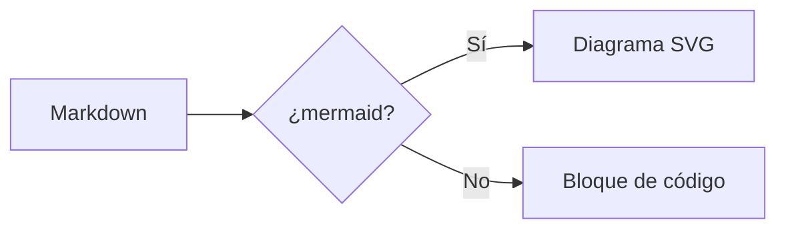

# Markdown Reader Test

This file exercises the renderer. Open it in Chrome after loading the extension.

## Text formatting

**Bold**, *italic*, ~~strikethrough~~, `inline code`, and a [link](https://example.com).

> A blockquote with some wisdom in it.

## Lists

1. First ordered item
2. Second ordered item
   - Nested bullet
   - Another nested bullet

- [x] Completed task
- [ ] Pending task

## Code

```python
def hello(name: str) -> str:
    return f"Hello, {name}!"
```

## Table

| Feature | Status |
|---------|--------|
| Tables  | ✅     |
| Dark mode | ✅   |
| Task lists | ✅  |

## Mermaid



## Sanitizer check

The next line contains a script tag in the source — it must NOT show an alert:

<script>alert("XSS")</script>

<a href="javascript:alert('XSS')">This link must be inert</a>

---

Press `r` to see the raw source.
